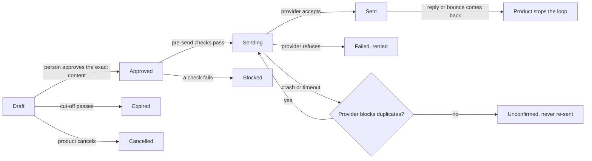

# Loopwright

**A Rust engine for human-approved reminder loops.** A product drafts a message, a person approves exactly what they saw, the engine sends it exactly once (even if the server crashes mid-send), replies and bounces come back and stop the loop, and every step is audited and kept to one tenant.

It powers a family of products for small businesses in the Philippines, each in its own repository:

| Product | What it chases | Status |
|---|---|---|
| [Kompleto](https://github.com/Enriquez-Johnmark/kompleto) ("complete") | Bookkeepers' clients, for the documents behind their BIR filings | Built |
| Balanse ("balance") | Customers, politely, about unpaid invoices | Next |
| Kotasyon ("quotation") | Leads, about quotes a service business sent | Planned |
| Biyahe ("trip") | Travelers, about tour inquiries | Planned |
| Iskedyul ("schedule") | Patients, about clinic and dental appointments | Planned |
| Resibo ("receipt") | Online sellers, about their sales records and BIR deadlines | Planned |

## The loop



## What it guarantees

- **Nothing is sent without approval.** Approval stores a hash of the exact content the person was shown; if the message changed since, the approval is refused. An unapproved draft expires.
- **Exactly once, even across crashes.** Each send carries an idempotency key recorded *before* the provider is called. After a crash or timeout, the engine retries only with a provider that blocks duplicate keys (Resend); otherwise it marks the message *unconfirmed* rather than risk a second email.
- **The product has the last word.** A product's own pre-send rules run at approval and again at sending, so a message whose recipient bounced or whose customer closed their account never goes out.
- **Tenants never mix.** Every query takes a `TenantId` and filters on it. Closing a tenant erases its messages, files and audit entries, and nothing else.
- **Replies and bounces close the loop.** Inbound email is parsed (out-of-office replies are recognised) and delivery events are verified by signature before anything trusts them.
- **Files are protected, then deleted.** Each uploaded file is encrypted with its own key (XChaCha20-Poly1305), scanned for viruses (fails closed if the scanner can't answer), and deleted at a deadline that only ever moves earlier.
- **The AI only words drafts.** The model client logs every call's tokens and cost; it never decides what to send or when. That is the product's code, under the person's approval.
- **Time is injected.** All logic reads a `Clock`, so tests (and demos) control time; direct system-clock calls are banned by lint.

## Modules

| Module | What it does |
|---|---|
| `outbox` | Drafts, approval by content hash, pre-send checks, expiry, cancellation, and the `Sender` that delivers exactly once under a daily budget |
| `mail` | The `Mailer` interface, with Resend (production) and Mailpit (development) |
| `inbound` | Parsing replies, recognising automatic replies, verifying signed inbound mail |
| `webhooks` | Verifying and parsing provider delivery events (bounces, complaints) |
| `files` | Encrypted file storage with per-file keys and deletion deadlines |
| `scan` | A clamd client that refuses any file it can't confirm is clean |
| `llm`, `cost_log` | A minimal model client and its per-tenant cost log |
| `jobs` | A Postgres job queue (`FOR UPDATE SKIP LOCKED`) with leases and retries |
| `audit` | An append-only audit log, enforced by a database trigger |
| `tenants` | Erasing one tenant's engine data |
| `clock`, `ids`, `signed` | Injected time, typed IDs, signed links |

Postgres is the only infrastructure: no Redis, no separate queue.

## Using it in a product

```toml
[dependencies]
loopwright = { git = "https://github.com/Enriquez-Johnmark/loopwright", tag = "v0.1.0" }
```

Run the engine's migrations next to your own (`loopwright::MIGRATOR.run(&pool)`), give it your pre-send rules by implementing `PreSendCheck`, and drive the loop from your scheduler. [`examples/approve_and_send.rs`](examples/approve_and_send.rs) is the whole loop in 40 lines:

```rust
let id = outbox.create_draft(tenant, &email).await?;
let seen = outbox.get(tenant, id).await?.content_hash();
outbox.approve(tenant, id, "owner@example.test", &seen, &NoExtraChecks).await?;
let report = sender.drain_once(10).await?;
```

## Development

```sh
docker compose up -d          # Postgres 17
cp .env.example .env          # for sqlx-cli
sqlx migrate run
cargo test
```

The rules for working on the engine (scope, safety rules, versions, commits) are in [`AGENTS.md`](AGENTS.md); design decisions are in [`docs/adr/`](docs/adr/); release notes in [`CHANGELOG.md`](CHANGELOG.md).

## History

Loopwright was built inside Kompleto, its first product, and moved to its own repository once a second product needed it. Its git history goes back to its first commit there.

## Licence

[AGPL-3.0-only](LICENSE). You may use, study and change it; if you run a modified version as a network service, you must offer its source to that service's users.

Contributions: the author also uses Loopwright in products that are not open source, so outside contributions can only be accepted with a contributor agreement. Please open an issue first.
